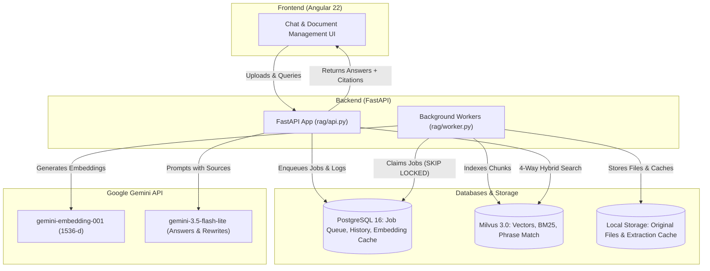
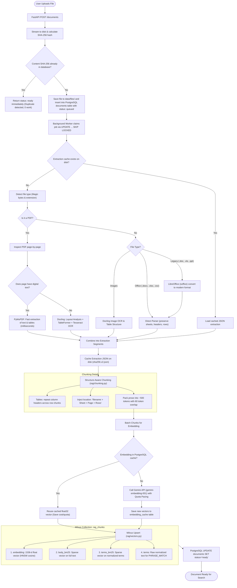
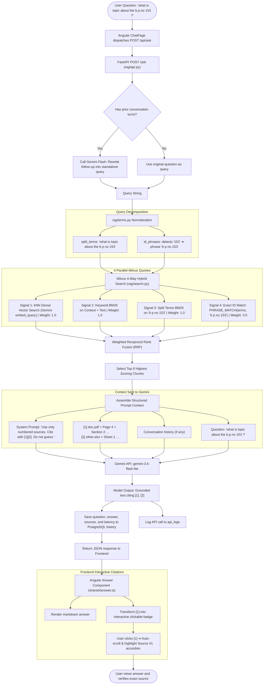

# Document Assistant RAG Pipeline: Step-by-Step Flowcharts

This document provides visual flowcharts and technical breakdowns for the two core pipelines in the system:
1. **Document Ingestion & Indexing Pipeline** (Upload ➔ Parsing ➔ Chunking ➔ Embedding ➔ Milvus)
2. **Query Retrieval & Answer Generation Pipeline** (Question ➔ 4-Way Hybrid Search ➔ Context Assembly ➔ Gemini LLM ➔ Interactive Citations)

---

## 1. High-Level Architecture Overview



---

## 2. Document Ingestion Pipeline (Step-by-Step)

When a user uploads a document (PDF, DOCX, XLSX, Image), this pipeline processes it once in the background.



---

## 3. Query Retrieval & Answer Generation Pipeline (Step-by-Step)

When a user asks a question like: **`"what is topic about the b.p.no 153 ?"`**:



---

## 4. Key Data Formats at Critical Steps

### A. What a Chunk Looks Like in Milvus
```json
{
  "id": "e3b0c44...-00004",
  "document_id": "e3b0c44...",
  "chunk_index": 4,
  "filename": "Tower_C_Approvals.pdf",
  "context": "Tower_C_Approvals.pdf > Page 4 > Approval Details",
  "text": "B.P. No. 153: Sanction of revised building plan for Tower C. Total area: 45,200 sq.m.",
  "body": "Tower_C_Approvals.pdf > Page 4 > Approval Details\nB.P. No. 153: Sanction of revised building plan...",
  "terms": "tower c approvals pdf page 4 approval details b p no 153 sanction of revised building plan...",
  "embedding": [0.0123, -0.0456, ...],
  "location": {"page": 4, "section": "Approval Details"}
}
```

### B. What is Sent to Gemini for Generating the Answer
```text
SYSTEM INSTRUCTIONS:
You are a helpful assistant that answers questions about the user's uploaded documents.
Use only the numbered sources provided.
- Cite every fact with its source number in square brackets, e.g. [2] or [1][3].
- Quote numbers, dates and names exactly as the sources give them, with their units.
- Use a short Markdown table when comparing several items.
- If sources disagree, say so and cite each.
- If the sources do not contain the answer, say you could not find it in the documents. Do not guess.

USER PROMPT:
Sources:

[1] Tower_C_Approvals.pdf > Page 4 > Approval Details
B.P. No. 153: Sanction of revised building plan for Tower C. Total area: 45,200 sq.m. Approved on 12/04/2023.

[2] Meeting_Minutes.pdf > Page 2
Pending files discussed: B.P. No. 153 was finalized after fire safety clearance.

Question: what is topic about the b.p.no 153 ?
```
