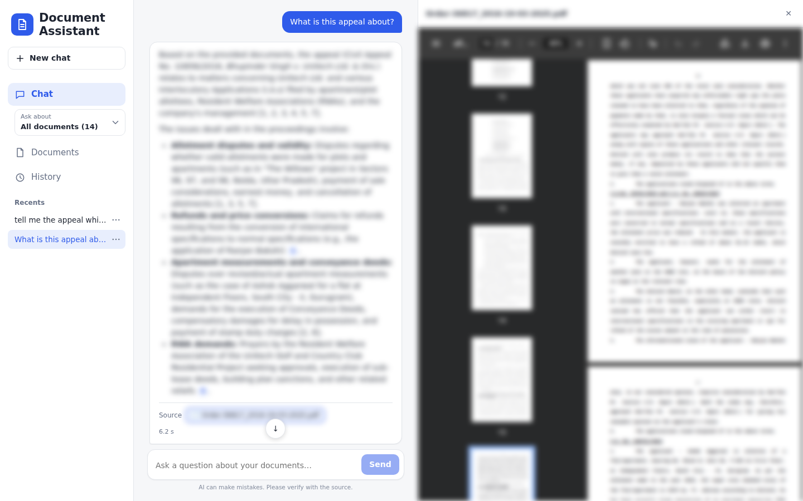
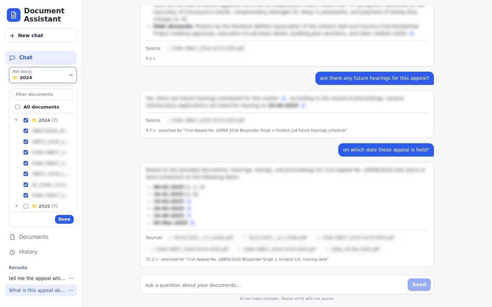
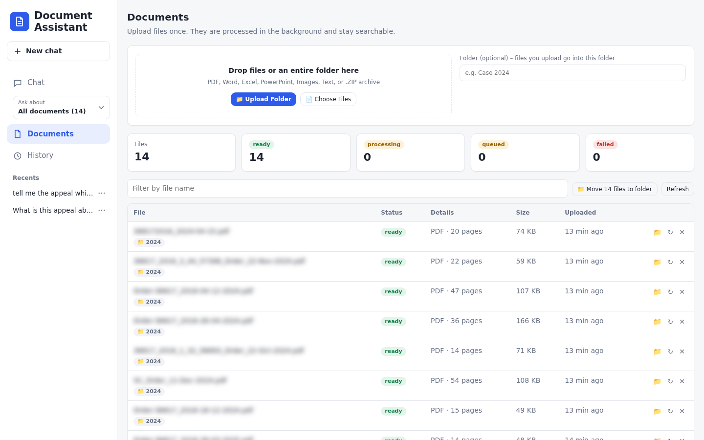
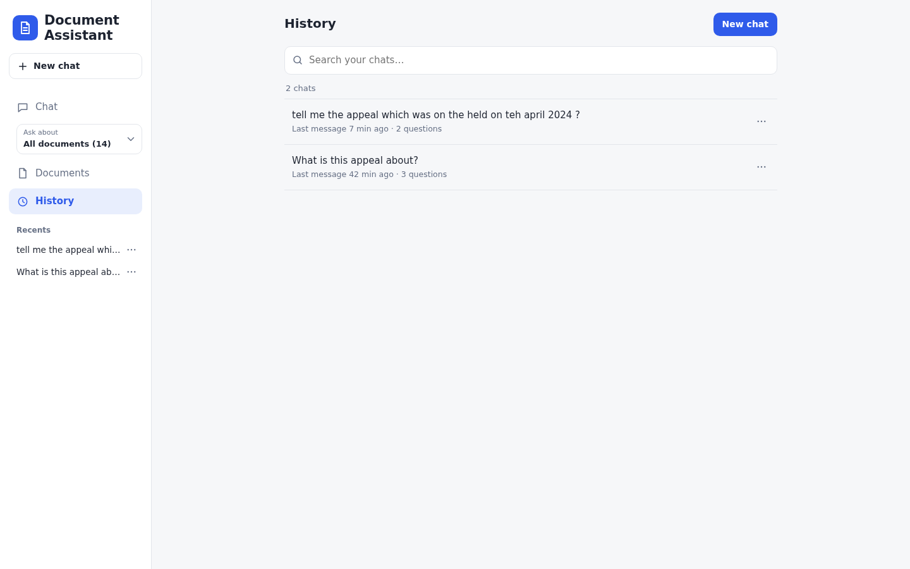
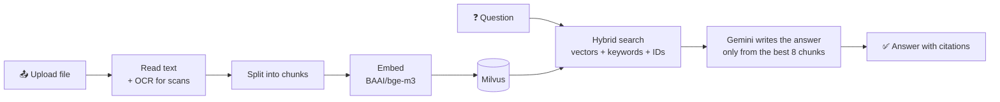

# 📄 Document Assistant

**Chat with your documents.** Upload PDFs, scans, Word, Excel or PowerPoint files, ask questions in plain
English, and get answers with **citations** that point to the exact page they came from.

Built as a full **RAG (Retrieval-Augmented Generation)** pipeline: FastAPI + Milvus + PostgreSQL + Angular,
with local OCR and local embeddings. Only the final answer is written by Gemini.


<sub>The answer names the file it came from. Click it and the PDF opens beside the chat at the right page.
(Document names and text are blurred in these screenshots.)</sub>

---

## ✨ Features

- **Any document** – text PDFs, scanned PDFs, images, `.docx`, `.xlsx`, `.csv`, `.pptx`, old `.doc/.xls`, and `.zip` archives or whole folders.
- **Reads scans** – OCR with [Docling](https://github.com/docling-project/docling) + Tesseract, including tables. Runs on your machine.
- **Answers with citations** – every fact in an answer is linked to the document and page it came from.
- **See the source PDF** – click a cited file (or a citation number) and the PDF opens in a side panel at that page.
- **Ask about one folder** – files are grouped by the folder they were uploaded from. Pick a whole folder or single
  files in **Ask about** (left sidebar), and questions search only those.
- **Smart search** – combines meaning (vector search), keywords (BM25) and exact IDs (`"B.P. No. 5"` finds `B_P_No_5`).
- **Follow-up questions** – "and when is the next hearing?" understands what "the" refers to.
- **Guardrails** – blocks prompt injection, removes made-up citations, checks that numbers really appear in the sources.
- **Processed once** – files are deduplicated by content; re-uploading the same file costs nothing.
- **Chat history** – searchable history, pinned chats, chat groups, and a log of every API call.

---

## 🖼️ Screenshots

| Ask about a folder | Documents |
|---|---|
|  |  |
| Tick a folder to ask only about its files, or open it (›) and pick single files. | Upload files or a whole folder. Each file shows its folder (📁); use 📁 to move files into a folder. |

| History |
|---|
|  |
| Every chat is saved and searchable. Pin, rename, group or delete chats. |

---

## 📁 Folders: ask about only some documents

1. **Upload into a folder** – on the **Documents** page, either click **📁 Upload Folder** (the folder's name is
   used), or type a name in **Folder** and then use **Choose Files**.
2. **Move files later** – click 📁 on a file's row, or filter the list and click **Move N files to folder**.
3. **Choose what to ask about** – in the left sidebar, open **Ask about**:
   - tick a folder → only its files are searched (the button shows **📁 folder name**),
   - open a folder with › → tick single files inside it,
   - **All documents** → search everything again.

---

## 🧠 How it works



1. **Upload** – the file is saved and queued. A background worker reads it (OCR only where a page has no text).
2. **Chunk & embed** – the text is split by headings and tables, then turned into vectors locally.
3. **Ask** – your question is searched four ways in Milvus, and the results are merged.
4. **Answer** – Gemini answers **only** from those chunks and must cite them. Guardrails check the result.

---

## 🧰 Tech stack

| Part | Technology |
|---|---|
| Frontend | Angular 22 |
| Backend | FastAPI (Python 3.11+) with background workers |
| Search | Milvus 3.0 (vector + BM25 + phrase match) |
| Database | PostgreSQL 16 (documents, job queue, chats, history) |
| OCR | Docling + Tesseract (local) |
| Embeddings | `BAAI/bge-m3` (local, English + Hindi) |
| Answers | Google Gemini |

---

## 🚀 Quick start

**You need:** Python 3.11+, Docker, Node.js 24+, Tesseract, LibreOffice, and a free
[Gemini API key](https://aistudio.google.com/apikey).

```bash
# 1. Get the code and add your key
git clone https://github.com/tarun-sai-31/RAG_Pipeline.git
cd RAG_Pipeline
cp .env.example .env            # open .env and set GEMINI_API_KEY

# 2. Start the databases (PostgreSQL + Milvus)
docker compose up -d

# 3. Backend: create the virtual environment and install the requirements
cd backend
python3 -m venv .venv
source .venv/bin/activate
pip install -r requirements.txt
fastapi dev                     # API on http://localhost:8000
```

In a **second terminal**:
```bash
# 4. Frontend
cd RAG_Pipeline/frontend
npm ci
npm start                       # app on http://localhost:4200
```

Open **http://localhost:4200** → go to **Documents** → drop in a file → when it says `ready`, ask a question in **Chat**.

📘 Step-by-step setup (installing Tesseract, working with `.venv`, Docker-only mode, troubleshooting) is in **[SETUP.md](SETUP.md)**.

---

## 💬 Example

Say you upload a rental agreement `lease_2025.pdf` and ask:

> **You:** When does the lease end and what is the notice period?

> **Assistant:** The lease runs for 11 months and ends on **31 March 2026** [1]. Either party must give
> **two months' written notice** before leaving [2].
>
> **Source** `📄 lease_2025.pdf` ← click to open the PDF beside the chat

Then a follow-up works without repeating yourself:

> **You:** And the deposit?

The question is rewritten to *"What is the security deposit in the lease?"* before searching.

*(This example is illustrative. Answers depend on your documents.)*

---

## 🔌 Use the API

Everything in the app is also available as a REST API, with interactive docs at **http://localhost:8000/docs**.
If you set `API_KEY` in `.env`, add `-H "X-API-Key: <your key>"` to each call.

**Upload a file**
```bash
curl -F "files=@lease_2025.pdf" http://localhost:8000/documents
```
```json
{ "documents": [ { "id": "3f9a…", "filename": "lease_2025.pdf", "status": "queued" } ] }
```

**Check its status** (`queued` → `processing` → `ready`)
```bash
curl http://localhost:8000/documents/3f9a…
```

**Ask a question**
```bash
curl -X POST http://localhost:8000/ask \
  -H "Content-Type: application/json" \
  -d '{"query": "When does the lease end?"}'
```
```json
{
  "answer": "The lease ends on 31 March 2026 [1].",
  "sources": [
    { "n": 1, "filename": "lease_2025.pdf", "location": { "page": 1 }, "text": "…", "score": 0.031 }
  ],
  "guardrails": { "status": "passed", "findings": [] },
  "conversation_id": "c843ce66…",
  "latency_ms": 1840
}
```
To ask a follow-up, send the same `conversation_id` and the earlier turns in `history`.
To ask about only some files (e.g. one folder), add their ids: `"document_ids": ["3f9a…", "b71c…"]`.

**Move a file into a folder**
```bash
curl -X PATCH http://localhost:8000/documents/3f9a… \
  -H "Content-Type: application/json" \
  -d '{"folder": "Case 2024"}'
```

**Get the original file** (what the side panel shows)
```bash
curl -o lease_2025.pdf http://localhost:8000/documents/3f9a…/file
```

**Search only (no answer)**
```bash
curl -X POST http://localhost:8000/search \
  -H "Content-Type: application/json" \
  -d '{"query": "notice period", "top_k": 5}'
```

**Load a whole folder from the command line**
```bash
cd backend && .venv/bin/python -m rag.cli ingest "/path/to/folder"
```

---

## 📁 Project structure

```
RAG_Pipeline/
├── backend/            FastAPI app + background workers
│   └── rag/            api, pipeline (extract → chunk → embed → index), search, guardrails, history
├── frontend/           Angular app (Chat, Documents, History pages)
├── docker-compose.yml  PostgreSQL + Milvus (and optionally the whole app)
├── .env.example        settings template → copy to .env
├── SETUP.md            detailed setup and technical docs
└── RAG_FLOWCHART.md    detailed pipeline diagrams
```

---

## 🧪 Tests

```bash
docker compose up -d
cd backend && .venv/bin/python -m pytest -q tests
```
Tests use a throwaway database and collection, so your data isn't touched.

---

## 🔒 Privacy note

OCR and embeddings run on your machine. To write an answer, the **question and the matching chunks are sent to
Google Gemini**. Use a paid Gemini key for confidential documents (free-tier data may be used by Google).
